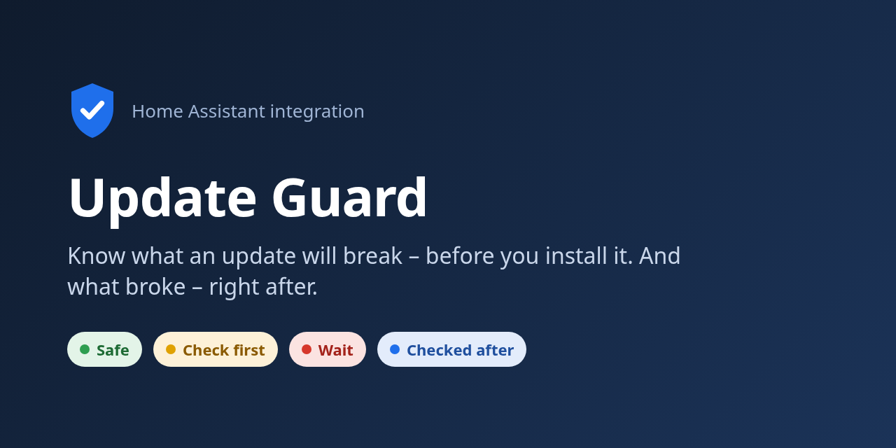
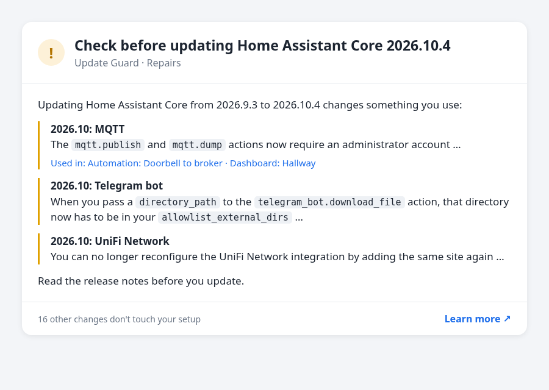
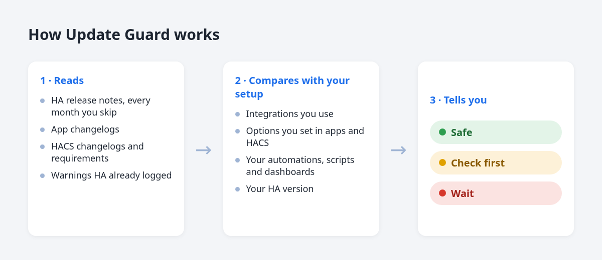
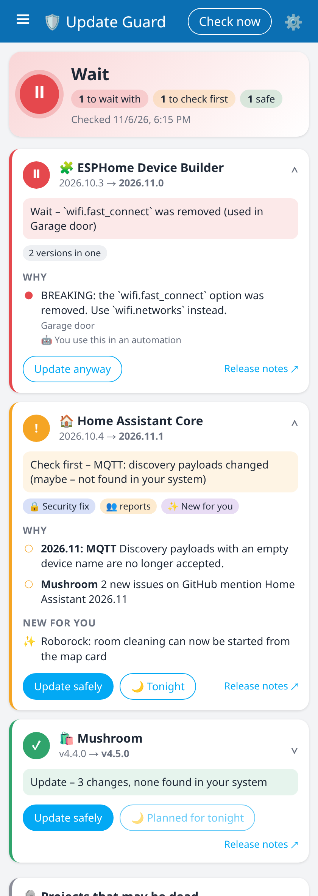
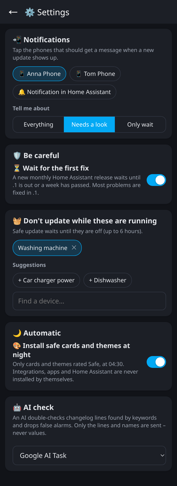
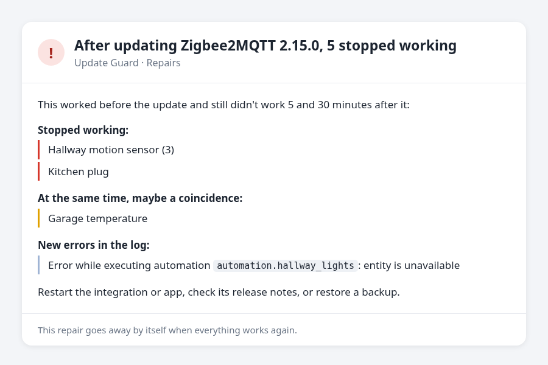

# Update Guard

**Know what an update will break – before you install it. And what broke – right after.**



[English](#english) · [Dansk](#dansk)

## English

Every month Home Assistant ships changes that can break things, and so do apps (add-ons) and HACS integrations. Most people don't read the release notes – they update and hope. Update Guard reads them for you and compares them with *your* setup.



### What it checks

| Update | What Update Guard does |
| --- | --- |
| **Home Assistant Core** | Reads the *Backward-incompatible changes* of every monthly release between your version and the new one (also if you skipped a few months) and keeps only the ones for integrations you actually use. |
| **Built-in integrations** (MQTT, Hue, UniFi …) | They update with Core, so they're covered above. Actions, options and sensors named in the notes are looked up in your automations, scripts and dashboards: *"Used in: Automation: Hallway lights"*. |
| **Apps (add-ons)** | Reads the changelog from your version to the new one. Options you have set in the app (e.g. Zigbee2MQTT's `serial` → `adapter`) are compared with it, so a renamed or removed option you use is caught. |
| **HACS integrations** | Same changelog and option check as apps, plus: if the new version needs a newer Home Assistant than you run, you're told to update Home Assistant first. |
| **Firmware and everything else** with an update entity (ESPHome, Zigbee, …) | Changelog scan for words like *breaking*, *removed*, *deprecated*. Everything in a *Breaking changes* section counts; developer changes like "Remove unused code" or "Fix deprecation warning" and bug fix sections don't. |
| **What HA already warned about** | Log warnings like *"custom integration X … will stop working in Home Assistant 2026.11"* and repairs with a "breaks in" version are linked to the update that will actually break them. |



### The verdict

- 🟢 **Safe** – nothing in the notes is found in your system.
- 🟡 **Check first** – it changes an integration you have, but nothing shows you use the changed part; or the developer says you must act; or other people report problems with this version.
- 🔴 **Wait** – something severe, **and proof from your own system**: an automation, script or dashboard uses it, an entity or attribute of yours is named, it's in your YAML, it's an option you set, Home Assistant itself warns, or it needs a newer Home Assistant.
- ⚪ **Unknown** – there were no release notes to read (or they couldn't be fetched), so nothing can be said. Never shown as safe.

> **Green is not a guarantee.** It means nothing in the release notes touches your setup. Changes that the developers didn't write down can't be found. Keep taking backups.

Every update gets **one line**, e.g. *"Wait – `wifi.fast_connect` removed (used in Living room light)"*. Every point says whether it's proven in your system (●) or only maybe (○). The same update can get a different answer in different homes, because it is your system that is searched – nothing is hard-coded.

You see it in three places: the sensor, **Settings → Repairs** (one repair per risky update, with what to look at and a link to the release notes), and the attributes of the sensor for dashboards and automations.

### The panel

**Update Guard** in the sidebar shows every pending update, the verdict, why, and buttons to update safely now or tonight.

<p align="center"> </p>

All settings are under **⚙️** in the panel and are saved right away: which phones get a message, what to be told about, wait for .1, devices that must not be interrupted (it suggests your washing machine and car charger), night install of safe cards and themes, and the AI check. They are also under **Settings → Devices & services → Update Guard → Configure**.

### More it does

- **Panel** in the sidebar with every update, the verdict, why, and buttons.
- **Safe update** (button in the panel, or the action `update_guard.safe_update`): refuses what says Wait, needs 2 GB free disk space, waits while the devices you chose are running (washing machine, car charger), and only takes a backup when last night's automatic backup doesn't cover it (cards and integrations never need one: they go back by installing the old version). Now or **tonight** at 04:30.
- **Go back:** if something stops working after an update, the repair has a button that installs the old version again (HACS) or restores the app's backup.
- **Other people's reports:** new GitHub issues that name the new version. Before a Home Assistant update it also searches your HACS projects for issues about the new Home Assistant version.
- **Skipped versions:** jumping from 1.9 to 2.1 reads the notes of 2.0 too.
- **Wait for .1** (option): a new monthly release is Check first until .1 is out or a week has passed.
- **Security fixes** are marked 🔒 and listed first. **New for you:** new features that name something you have.
- **Dead projects:** HACS projects that are archived or unchanged for two years.
- **Auto-install** (option, off by default): safe cards and themes at night. Never integrations, apps or Home Assistant.
- Firmware without release notes stays ⚪ but doesn't turn the overall assessment Unknown.

### After the update



Update Guard keeps a snapshot of what works (available entities and loaded integrations) every 10 minutes. When an update has been installed – an app, a HACS integration, firmware, or Home Assistant itself – it checks again **5 and 30 minutes** later:

- Only what worked before and is **still** broken at both checks is reported. Things that are unavailable for a minute during a restart, or that were already broken, are not.
- What belongs to the update is told apart from what broke at the same time, which may be a coincidence:
  > **🔴 After Zigbee2MQTT 2.15.0: 5 stopped working**
  > Stopped working: Hallway sensor (3), Kitchen plug
  > At the same time, maybe a coincidence: Garage temperature
- New errors in the log from the updated integration or from automations are listed too.
- You get a repair (and a notification, if you turned them on). It goes away by itself when everything works again.
- Updates installed close together are checked as one. A restart (e.g. to load a HACS update) starts the checks over.

It says *after*, not *because of*: it can't know why something stopped working, only that it worked before.

### Installation

1. Open **HACS** → ⋮ (top right) → **Custom repositories**.
2. Repository: `https://github.com/Clahen86/ha-update-guard` · Type: **Integration** → **Add**.
3. Search for **Update Guard** in HACS → **Download**.
4. Restart Home Assistant.
5. **Settings → Devices & services → Add integration → Update Guard → Submit.** There is nothing to fill in.

That's it. It checks every 6 hours and right away whenever a new update shows up.

### Notifications on your phone

Open **Update Guard → ⚙️** in the sidebar (or **Settings → Devices & services → Update Guard → Configure**) and tap one or more phones (`notify.mobile_app_…`). Every new update then sends a notification with the verdict, for example:

> **🔴 Home Assistant Core 2026.11.0 – Wait**
> 2026.11: MQTT: The `mqtt.publish` action now requires … (used in: Doorbell to broker)

Tap it to open Repairs. Each version is announced once (again only if the verdict gets worse), and several updates at once come as one message. You can choose to hear about all updates, only those to check, or only those to wait with.

### AI check (optional)

Changelogs are free text, so a keyword search can still raise a false alarm, e.g. "32-bit support is deprecated" when you run 64-bit. With the AI check, every 🟡 or 🔴 update from an app, HACS or firmware gets a second opinion: the AI reads the flagged lines and says for each one whether it touches you, and why.

- Lines it finds irrelevant move to the bottom with a 🤖 note and no longer count. The ones that stay get a 🤖 note in the repair.
- Core release notes, log warnings, repairs and "needs a newer Home Assistant" are facts and are never changed by the AI.
- Each update version is asked about once (usually 1–3 calls a month). If the AI fails or the quota is used up, the normal verdict is used.
- **What is sent:** the flagged changelog lines, your Home Assistant version, and the *names* of integrations, devices and options that the lines mention. Never values, never your whole setup.

#### Set it up with Google Gemini (free, 5 minutes)

1. Go to **[aistudio.google.com/apikey](https://aistudio.google.com/apikey)** and sign in with a Google account.
2. Tap **Create API key** → **Create API key in new project**.
   > **Tip: give Update Guard its own key in its own project.** The free quota is per project. If you also use Gemini for voice or other integrations, they would otherwise share the same daily quota, and one could use it up for the others.
3. Copy the key (starts with `AIza…`).
4. In Home Assistant: **Settings → Devices & services → Add integration → Google Generative AI** → paste the key → **Submit**.
   - Already have Google Generative AI with another key? Add it once more with the new key – each key becomes its own entry.
5. This creates an AI Task entity, e.g. `ai_task.google_ai_task`. Rename it to "Update Guard" so you know what it's for.
6. **Update Guard → ⚙️ → AI check** in the sidebar → pick that entity. It's saved right away.

Other AI Task integrations (OpenAI, Anthropic, Ollama …) work too.

### Entities

Entity IDs follow your Home Assistant language. In English:

| Entity | What |
| --- | --- |
| `sensor.update_guard_assessment` | `safe`, `check`, `wait`, `unknown` or `none`. The `updates` attribute has the details for each update. |
| `sensor.update_guard_things_to_check` | Number of changes that touch your setup. |
| `button.update_guard_check_now` | Check again right away. |

### Example: dashboard card

```yaml
type: markdown
content: >
  
  **{{ u.name }}** {{ u.installed }} → {{ u.latest }}: {{ u.level }}
  
  - {{ f.title }} {{ f.text }}
  
  
  No pending updates.
  
```

### FAQ

**Does it need AI or an API key?** No. Everything is read from the official release notes and changelogs. The [AI check](#ai-check-optional) is optional and only removes false alarms.

**Does it send my setup anywhere?** Not without the AI check: it only downloads public release notes from GitHub, only option *names* are read, and nothing leaves your Home Assistant. With the AI check, the flagged lines and the names they mention are sent to the AI service you picked.

**Does it work without HA OS?** Yes. On Container and Core installs there are no apps, and the latest Core version is taken from GitHub.

**Can it be wrong?** Yes, sometimes:
- Core matching is by integration. "MQTT changed" means you use MQTT, not necessarily the exact feature that changed.
- App and HACS changelogs are free text, so they're scanned for keywords. That can give false alarms (turn on the AI check to catch most of them), and a change that isn't described can't be found.
- "Used in" only finds names written as code (`like_this`) in the notes.
- Many firmware updates and the Home Assistant OS update come without real release notes. They show as ⚪ Unknown.
- Patch releases of Home Assistant (e.g. 2026.10.4 → 2026.10.5) only contain bug fixes by policy and are not checked line by line.
- Integrations installed by hand (not via HACS) have no update entity, so only their log warnings are seen.

**What's next?** Ideas and wishes are welcome as issues on GitHub.

### Help and answers

Press **🛟 Help** at the top of the panel to write what's wrong and attach up to 3 pictures. It goes privately to the developer with a short diagnosis (no names, addresses or passwords) – only when you press *Send*. When the developer answers – also on an error the app reported – the answer shows under 🛟 Help with a notification in Home Assistant, and you can write back. Errors in the app are sent anonymously so they can be fixed; turn it off under 🛟 Help.

## Dansk

Hver måned kommer der ændringer i Home Assistant, apps og HACS-integrationer, som kan ødelægge noget. De færreste læser release notes. Update Guard læser dem for dig og holder dem op mod *din* opsætning.

### Det tjekker den

- **Home Assistant Core:** Den læser *Backward-incompatible changes* for alle månedlige udgivelser fra din version til den nye, også hvis du har sprunget måneder over. Den viser kun ændringer for integrationer, du faktisk bruger.
- **Indbyggede integrationer:** De bliver opdateret sammen med Core. Actions, indstillinger og sensorer, der nævnes i release notes, slår den op i dine automatiseringer, scripts og dashboards, fx *"Bruges i: Automatisering: Lys i gangen"*.
- **Apps (add-ons):** Den læser changelog og holder den op mod de indstillinger, du har sat i appen.
- **HACS-integrationer:** Den laver samme tjek som for apps. Derudover får du besked om at opdatere HA først, hvis den nye version kræver en nyere HA.
- **Firmware og alt andet** med en opdatering (ESPHome, Zigbee osv.): Den leder i changelog efter ord som *breaking*, *removed* og *deprecated*. Alt i et afsnit med *Breaking changes* tæller med. Ændringer for udviklere, som "Remove unused code" og "Fix deprecation warning", og afsnit med fejlrettelser tæller ikke.
- **Det HA allerede har advaret om:** Advarsler i loggen og reparationer med en "går i stykker i"-version kobles til den opdatering, hvor de rent faktisk går i stykker.

### Efter opdateringen


Update Guard gemmer hvert 10. minut et øjebliksbillede af, hvad der virker, dvs. hvilke enheder der er tilgængelige, og hvilke integrationer der er startet. Når en opdatering er installeret, tjekker den igen **5 og 30 minutter** efter. Det gælder apps, HACS-integrationer, firmware og selve Home Assistant.

- Den melder kun det, der virkede før og **stadig** er i stykker ved begge tjek. Det, der kun er utilgængeligt et øjeblik under en genstart, eller som var i stykker i forvejen, melder den ikke.
- Den skelner mellem det, der hører til opdateringen, og det, der gik i stykker samtidig, hvilket kan være tilfældigt.
- Nye fejl i loggen fra den opdaterede integration eller fra automatiseringer kommer også med.
- Du får en reparation og en besked, hvis du har slået beskeder til. Reparationen forsvinder af sig selv, når det hele virker igen.
- Opdateringer, der installeres tæt på hinanden, tjekkes samlet. En genstart, fx for at indlæse en HACS-opdatering, starter tjekket forfra.

Den skriver "efter", ikke "på grund af". Den kan ikke vide, hvorfor noget holdt op med at virke, kun at det virkede før.

### Vurderingen

- 🟢 **Sikker:** Intet i release notes findes i dit system.
- 🟡 **Tjek først:** En integration, du har, ændres, men intet viser, at du bruger den ændrede del. Eller udvikleren skriver, at du skal gøre noget, eller andre melder fejl i versionen.
- 🔴 **Vent:** Noget alvorligt, **og bevis fra dit eget system**: en automation, et script eller dashboard bruger det, din enhed eller attribut nævnes, det står i din YAML, det er din egen indstilling, HA advarer selv, eller den kræver en nyere HA.

Hver opdatering får **én linje**, fx *"Vent – `wifi.fast_connect` fjernet (bruges i Lys stue)"*. Den samme opdatering kan give forskelligt svar i forskellige hjem, fordi det er dit system, der søges i.
- ⚪ **Ukendt:** Der var ingen release notes at læse, eller de kunne ikke hentes. Den bliver aldrig vist som sikker.

> **Grøn er ikke en garanti.** Den betyder, at intet i release notes rører din opsætning. Ændringer, som udviklerne ikke har skrevet ned, kan den ikke finde. Tag stadig backup.

Du ser vurderingen i **panelet** i sidemenuen, på sensoren og under **Indstillinger → Reparationer**.

### Panelet

**Opdateringsvagt** i sidemenuen viser alle ventende opdateringer med dommen, hvorfor, og knapper til at opdatere sikkert nu eller i nat. Alle indstillinger ligger under **⚙️** og gemmes med det samme: telefoner, hvad du vil have besked om, vent på .1, enheder der ikke må afbrydes (den foreslår selv vaskemaskine og lader), natlig installation af sikre kort og temaer og AI-kontrol.

<p align="center"> </p>

### Mere den kan

- **Opdater sikkert:** siger nej til Vent, kræver 2 GB ledig plads, venter mens dine valgte enheder kører, og tager kun backup, hvis nattens ikke dækker. Nu eller **i nat** kl. 04:30.
- **Gå tilbage:** går noget i stykker, har reparationen en knap, der installerer den gamle version igen.
- **Andre melder fejl:** nye GitHub-issues, der nævner versionen. Før en HA-opdatering tjekker den også dine HACS-projekter.
- **Oversprungne versioner** læses med. **Vent på .1** (valgfrit). **🔒 Sikkerhedsrettelser** først. **Nyt for dig.**
- **Døde projekter:** arkiveret eller uændret i to år.
- **Auto-installér** sikre kort og temaer om natten (valgfrit, slået fra).

### Installation

1. **HACS** → ⋮ (øverst til højre) → **Brugerdefinerede repositories**.
2. Repository: `https://github.com/Clahen86/ha-update-guard` · Type: **Integration** → **Tilføj**.
3. Søg efter **Update Guard** i HACS → **Download**.
4. Genstart Home Assistant.
5. **Indstillinger → Enheder og tjenester → Tilføj integration → Update Guard → Send.** Der er intet at udfylde.

Den tjekker hver 6. time og med det samme, når der kommer en ny opdatering.

### Besked på telefonen

Åbn **Opdateringsvagt → ⚙️** i sidemenuen (eller **Indstillinger → Enheder og tjenester → Update Guard → Konfigurer**), og tryk på en eller flere telefoner (`notify.mobile_app_…`). Så får du en besked med vurderingen, hver gang der kommer en ny opdatering. Tryk på den for at åbne Reparationer. Du kan vælge, om du vil have besked om alle opdateringer, kun dem, der skal tjekkes, eller kun dem, du skal vente med.

### AI-kontrol (valgfri)

Changelogs er fri tekst, så nøgleord kan stadig give en falsk alarm, fx "32-bit understøttes ikke længere", selvom du kører 64-bit. Med AI-kontrollen får alle 🟡 og 🔴 opdateringer af apps, HACS og firmware en ekstra vurdering. AI'en læser de fundne linjer og siger for hver linje, om den rammer dig, og hvorfor.

- Linjer, den ikke finder relevante, flyttes ned med en 🤖-note og tæller ikke længere med. De linjer, der bliver, får en 🤖-note i reparationen.
- Release notes for Core, advarsler i loggen, reparationer og "kræver en nyere HA" er fakta. Dem ændrer AI'en aldrig.
- Den spørger kun én gang pr. version, typisk 1–3 kald om måneden. Fejler AI'en, eller er kvoten brugt op, bruges den almindelige vurdering.
- **Det sendes:** de fundne linjer, din HA-version og *navnene* på de integrationer, enheder og indstillinger, som linjerne nævner. Aldrig værdier og aldrig hele din opsætning.

#### Sådan sætter du det op med Google Gemini (gratis, 5 minutter)

1. Gå til **[aistudio.google.com/apikey](https://aistudio.google.com/apikey)**, og log ind med en Google-konto.
2. Tryk **Create API key** → **Create API key in new project**.
   > **Tip: Giv Update Guard sin egen nøgle i sit eget projekt.** Den gratis kvote gælder pr. projekt. Bruger du også Gemini til stemmestyring eller andre integrationer, deler de ellers den samme kvote pr. dag, og én kan bruge den op for de andre.
3. Kopiér nøglen (den starter med `AIza…`).
4. I Home Assistant: **Indstillinger → Enheder og tjenester → Tilføj integration → Google Generative AI** → indsæt nøglen → **Send**.
   - Har du allerede Google Generative AI med en anden nøgle? Tilføj den én gang til med den nye nøgle. Hver nøgle bliver sin egen post.
5. Der laves en AI Task-enhed, fx `ai_task.google_ai_task`. Omdøb den gerne til "Update Guard", så du kan se, hvad den bruges til.
6. **Opdateringsvagt → ⚙️ → AI-kontrol** i sidemenuen → vælg enheden. Det gemmes med det samme.

Andre AI Task-integrationer (OpenAI, Anthropic, Ollama osv.) virker også.

### Enheder

På dansk hedder enhederne `sensor.update_guard_vurdering`, `sensor.update_guard_ting_at_tjekke` og `button.update_guard_tjek_nu`. Dashboard-eksemplet ovenfor virker også på dansk, når du skifter navnene ud.

Menuer og beskeder er på dansk. Selve teksten fra udviklerne er på engelsk.

**Kræver den AI?** Nej. AI-kontrollen er valgfri. Uden den sender den ikke noget om din opsætning ud af huset. Med den sendes kun de fundne linjer og de navne, de nævner, til den AI-tjeneste, du har valgt.

### Hjælp og svar

Tryk på **🛟 Hjælp** øverst i panelet for at skrive, hvad der er galt, og vedhæfte op til 3 billeder. Det går privat til udvikleren med en kort diagnose (ingen navne, adresser eller koder) – kun når du trykker *Send*. Når udvikleren svarer – også på en fejl, appen har sendt – står svaret under 🛟 Hjælp, og du får en besked i Home Assistant. Du kan skrive tilbage derfra. Fejl i appen sendes anonymt, så de kan blive rettet; slå det fra under 🛟 Hjælp.

## License

MIT
